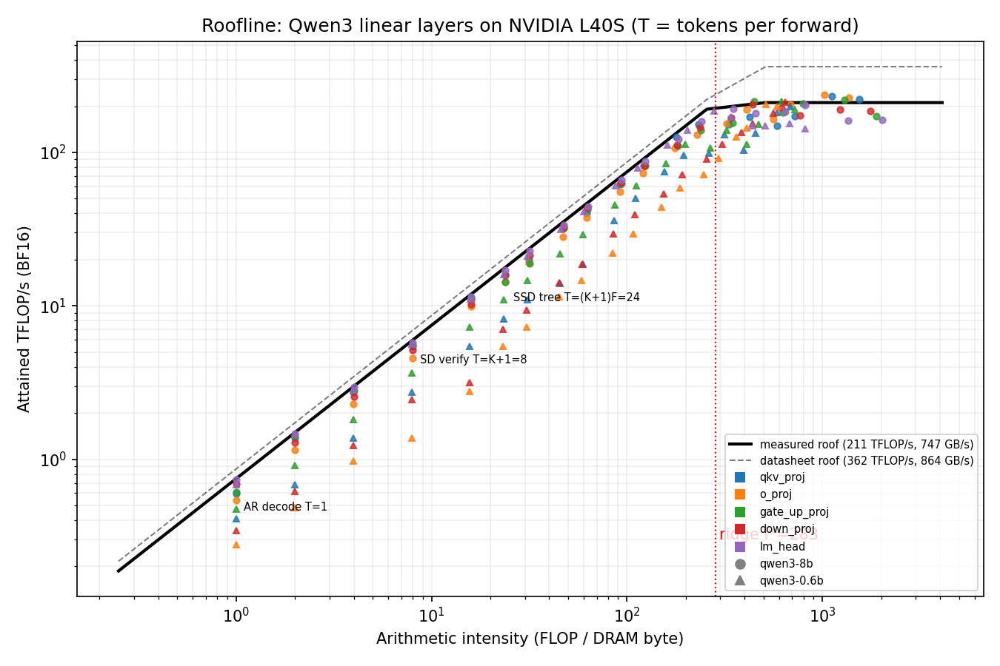
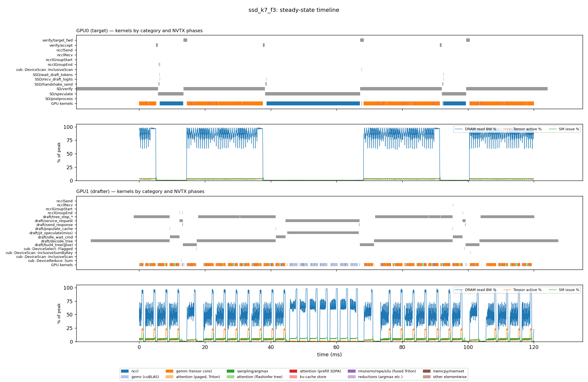
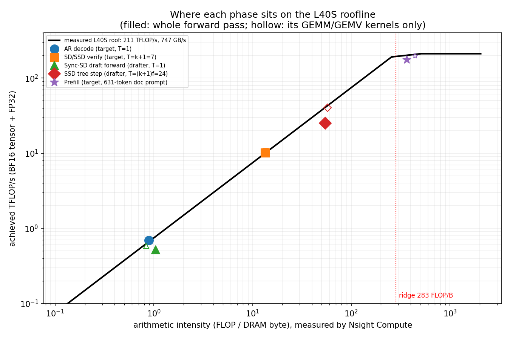
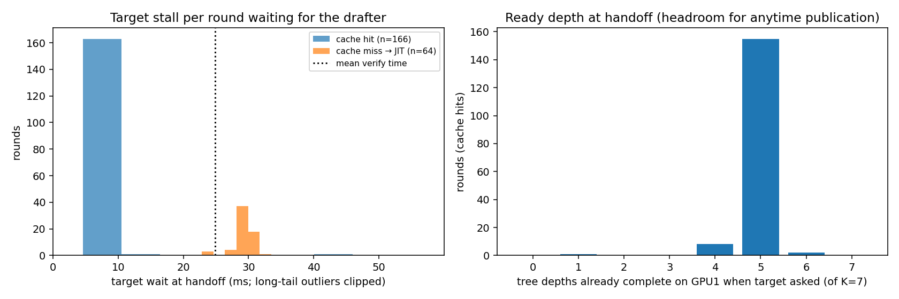

# Performance analysis: speculative decoding (SD) vs speculative speculative decoding (SSD) on L40S

*Anytime Outcome-Cache Construction — Week 1 baseline profiling. Qwen3-8B target, Qwen3-0.6B drafter,
greedy, batch size 1, BF16, on 2× NVIDIA L40S (one node, GPUs on different NUMA sockets, PCIe, no NVLink).*

Method follows the course's performance-analysis lecture: (1) build an empirical **roofline** for the
machine, (2) **Nsight Systems** to find where wall time goes and where GPUs sit idle, (3) **Nsight Compute**
Speed-of-Light → classify kernels as memory/compute/latency-bound → drill into occupancy, memory workload,
warp stalls, roofline position. Reproduction commands: `profiling/README.md`. Raw numbers: `results/`.

## 0. TL;DR

| | AR (target only) | Sync SD (k=6) | SSD (k=7, f=3, JIT backup) |
|---|---|---|---|
| Committed tokens/s (3 prompts × 256 tok, under nsys) | **44.0** | **62.5** (1.42×) | **80.6** (1.83×) |
| Mean time per engine step | 22.4 ms | 49.6 ms | 39.9 ms |
| Tokens committed per step | 1.00 | 3.57 | 3.85 |
| Target GPU doing useful work | 94% | 80% | **57%** (35% spinning in NCCL waiting for the drafter) |
| Drafter GPU busy | — | (same GPU) | 70% |
| Dominant bound of decode kernels | memory (DRAM 95% SOL) | memory | memory (target); latency + host overhead (drafter) |

1. **Every decode-phase forward is DRAM-bandwidth-bound.** Verifying 7 tokens (22.2 ms) costs the same as
   decoding 1 token (23.1 ms): both stream the 15 GB of weights at ~750 GB/s. The roofline crossover to
   compute-bound needs **≈280–300 tokens per forward** (measured ridge 283 FLOP/B); only prefill gets there
   (GEMMs at 198 TFLOP/s, 94% of the measured BF16 roof).
2. **Sync SD is limited by serial drafting + host overhead:** half of each step is 7 sequential drafter
   forwards (3.5 ms each, of which ~1.1 ms the GPU is idle waiting for the CPU between forwards).
3. **SSD on this hardware is drafter-bound, not target-bound.** The target spends **38% of decode time
   stalled** at the handoff: on cache hits (72%) it waits 9.2 ms for the drafter to finish the last tree
   depths; on misses (28%) it waits 30 ms for JIT drafting. The drafter's per-round work
   (glue 4.3 ms + 7 tree steps × 3.6 ms) exceeds the 24.9 ms verify.
4. **Headroom for our project is real and measured:** when the target asks for the next speculation, **5 of
   7 tree depths are already complete on the drafter GPU in 93% of hit rounds.** An anytime cache that hands
   over the ready depth-5 prefix would remove most of the ~8 ms/round hit stall. See §6.

## 1. Setup and what had to change

* Engine: official SSD repo (`tanishqkumar/ssd` @ d7eb8fa), vendored at `third_party/ssd`. Upstream targets
  H100; three changes were needed for L40S (details in `third_party/ssd/UPSTREAM.md`):
  * Upstream attention calls FlashAttention-3 (`sgl_kernel`), **Hopper-only**. We added a split-KV Triton
    paged-attention kernel (decode + multi-token verify/glue, CUDA-graph safe; validated against a dense
    reference, `tests/test_paged_attention.py`) and SDPA for prefill. The SSD drafter's tree attention still
    uses flashinfer as upstream.
  * flashinfer 0.5 → 0.6 API drift (sampler RNG helper, `plan()` arity).
  * NVTX ranges on every algorithmic phase.
* Topology: SSD places the target on GPU0 and the drafter on GPU1; the two L40S are on different sockets
  (`nvidia-smi topo`: SYS). Handoff traffic per round is small (tokens + B×K×V BF16 logits ≈ 2.1 MB).
* Workload: 1 prompt per family (chat: Spec-Bench MT-bench, code: HumanEval, doc: Spec-Bench RAG/summ.),
  Qwen3 chat template (thinking off), 256 output tokens, `ignore_eos`, 3 warm-up requests first.
  Small sample — fine for mechanism, **not** for headline speedups (that is Week 3's job).

## 2. Roofline for the L40S (slides: "Constructing the model for any machine")

`profiling/roofline_microbench.py`, `results/roofline/`.

| Quantity | Datasheet | Measured |
|---|---|---|
| Peak BF16 dense tensor (π) | 362 TFLOP/s | **211 TFLOP/s** (8192³ GEMM; power/clock-limited, median 190) |
| Peak FP32 CUDA-core | 91.6 TFLOP/s | 48.6 TFLOP/s |
| DRAM bandwidth (β) | 864 GB/s | **747 GB/s** read, 656 GB/s copy |
| L2 bandwidth (96 MB L2) | — | 2.98 TB/s |
| Ridge point I* = π/β | 419 FLOP/B | **283 FLOP/B** |

For a linear layer with T tokens per forward (BF16 weights), AI ≈ T FLOP/B, so **a forward becomes
compute-bound at T ≈ 280–300 tokens**. Sweeping every Qwen3 linear-layer shape over T
(`forward_vs_tokens.png`; weights rotated so each GEMM streams from DRAM, not the 96 MB L2):

| tokens per forward T | 1 | 8 | 24 | 64 | 128 | 256 | 384 | 512 | 1024 |
|---|---|---|---|---|---|---|---|---|---|
| Qwen3-8B linear layers (ms) | 24.0* | 22.6 | 24.2 | 23.0 | 23.7 | 27.1 | 36.3 | 38.5 | 80.0 |
| Qwen3-0.6B linear layers (ms) | 2.7 | 3.2 | 3.1 | 3.2 | 2.9 | 3.2 | 4.2 | 4.6 | 8.3 |

\*T=1 uses cuBLAS GEMV, slightly slower than the T≥2 tensor-core GEMM path.

Where each phase sits: AR decode T=1 (AI≈1), verify T=k+1 = 7 (SD, k=6) or 8 (SSD, k=7), SSD drafter tree step
T=(k+1)·f=24 (AI≈24), prefill T=prompt length (AI in the hundreds). **Everything except prefill is far left
of the ridge**: the cost of a decode-phase forward is set by bytes moved, not FLOPs. Consequences:
* Verification width is nearly free up to ~128 tokens per forward → wider/deeper speculation does not raise
  the target's cost; acceptance and drafter cost are what matter.
* The drafter's tree step (24 rows) costs about the same as a single-token drafter forward → fan-out is cheap
  for the drafter too; **depth** (sequential steps) is what costs time.

## 3. Nsight Systems: where the time goes and where GPUs idle

`profiling/run_nsys.sh`, `profiling/analyze_nsys.py`; figures `results/nsys/*_timeline.png`.
GPU-metrics sampling (20 kHz) gives DRAM-read %, SM-issue % and tensor-active % per phase.

### 3.1 AR (target only)
* GPU0 busy 94.3%; **96% of GPU time is cuBLAS GEMV**.
* Hardware counters during decode: **DRAM read 89% of peak, SM issue 6.4%, tensor active 0.1%** →
  textbook memory-bound GEMV (slides: "single-request decode is fundamentally memory-bandwidth-bound").
* 22.4 ms/token vs a 20.2 ms floor (15.1 GB of linear weights at 747 GB/s) → 90% of attainable.
* Idle (5.7%): mostly around prefill and per-step Python/sampling (one GPU→CPU sync per token).

### 3.2 Synchronous SD (k=6)
Per step (49.6 ms): `SD/speculate` 24.9 ms (7 drafter forwards) + `SD/verify` 24.9 ms.
* Verify: DRAM read 87.7%, SM issue 3.4%, tensor active 2.9% → memory-bound, ~same cost as one AR step.
* Drafter forwards: each 3.49 ms wall but only **2.42 ms of GPU work**; DRAM read only ~50% while running.
  The difference (~1.1 ms per forward, ~7.5 ms per step) is **GPU idle waiting on the host**: Python
  bookkeeping, `prepare_decode_tensors`, and a blocking `.tolist()`/`.any()` sync after every draft token.
* GPU0 idle 19.8% overall, almost all of it inside the drafter phase (idle-gap histogram: 2 141 gaps of
  0.1–1 ms, 19 k gaps of 20–100 µs).
* 3.57 committed tokens/step → 1.42× over AR. The drafter's serial depth costs as much as the verify.

### 3.3 SSD (k=7, f=3, JIT backup)
Target (GPU0) per step (39.9 ms): `SD/verify` 24.9 ms + `SD/speculate` 15.1 ms (handshake + **waiting**).
* While waiting, GPU0 runs NCCL receive kernels that spin until the drafter's data arrives: **3.36 s of the
  9.53 s window (35%) is NCCL spin**, plus 7.6% true idle → target useful-busy only 57%.
* Verify kernels themselves are identical to sync SD (memory-bound, 87.5% DRAM read).

Drafter (GPU1), per round, serially after receiving the request:
| phase | mean | notes |
|---|---|---|
| `draft/service_request` | 7.4 ms | cache lookup; on a miss runs `jit_speculate` (23 ms, 7 serial GEMV forwards) |
| `draft/build_tree(glue)` | 4.3 ms | glue decode of the accepted suffix for all fan-out branches |
| `draft/decode_tree` | 25.4 ms | 7 tree steps × 3.6 ms, each over (k+1)·f = 24 rows (flashinfer tree attention) |
| `draft/idle_wait_cmd` | 3.8 ms | CPU idle; GPU is still draining the launched tree kernels |

* GPU1 busy 72.8%; while busy, DRAM read only ~47%, SM issue ~4%, tensor active ~5% → drafter kernels are
  small (0.6B model: 1 024-wide GEMMs, 130 kernels/ms) and **latency/launch-bound**, not at the BW roof.
* GPU1 idle 27%: per-tree-step flashinfer `plan()` on the host with an event sync, glue construction,
  and Python control between steps (idle in `tree_step_0`, `build_tree(glue)`, `jit_speculate`).
* Critical path: glue (4.3) + tree (25.4) = 29.7 ms > verify 24.9 ms, so the target waits on every round.

## 4. Nsight Compute: per-kernel bound classification

`profiling/run_ncu.sh`, `profiling/analyze_ncu.py`; one steady-state forward per phase, NVTX-selected,
clocks unlocked. Bound rule (slides, top-down step 2): memory-bound if memory SOL ≥ 60% and dominates,
compute-bound if compute SOL ≥ 60% and dominates, else latency-bound. Columns are kernel-time-weighted.

| phase | kernels | sum of kernel time | AI (FLOP/B) | DRAM GB/s | TFLOP/s | memory / compute / latency-bound (% of time) |
|---|---|---|---|---|---|---|
| AR decode (target, T=1) | 540 | 23.06 ms | 0.9 | 780 | 0.7 | 95 / 0 / 5 |
| SD/SSD verify (target, T=k+1=7) | 545 | 22.21 ms | 13.5 | 748 | 10.1 | 95 / 0 / 5 |
| Sync-SD draft forward (drafter, T=1) | 470 | 3.10 ms | 1.0 | 499 | 0.5 | 71 / 0 / 29 |
| SSD tree step (drafter, T=(k+1)f=24) | 320 | 2.24 ms | 54.5 | 460 | 25.1 | 63 / 0 / 37 |
| Prefill (target, 631-token doc prompt) | 557 | 51.92 ms | 365.2 | 476 | 174.0 | 11 / 85 / 4 |

**AR decode (target, T=1)** — kernel families (time-weighted)

| family | time % | SOL compute % | SOL memory % | achieved occupancy % | issue active % | AI | top warp stalls |
|---|---|---|---|---|---|---|---|
| gemv (cuBLAS) | 95.3 | 13.6 | 94.6 | 24.0 | 7.1 | 0.9 | long_scoreboard, lg_throttle, barrier |
| rmsnorm/rope/silu (fused Triton) | 2.7 | 0.1 | 1.3 | 15.2 | 10.3 | 1.1 | long_scoreboard, imc_miss, selected |
| attention (paged, Triton) | 1.3 | 5.5 | 14.3 | 11.2 | 15.3 | 11.7 | long_scoreboard, imc_miss, barrier |

**SD/SSD verify (target, T=k+1=7)** — kernel families (time-weighted)

| family | time % | SOL compute % | SOL memory % | achieved occupancy % | issue active % | AI | top warp stalls |
|---|---|---|---|---|---|---|---|
| gemm (tensor core) | 93.9 | 9.1 | 91.2 | 7.4 | 5.3 | 13.6 | long_scoreboard, wait, selected |
| rmsnorm/rope/silu (fused Triton) | 2.7 | 1.0 | 5.6 | 16.5 | 11.2 | 1.5 | long_scoreboard, imc_miss, wait |
| attention (paged, Triton) | 1.9 | 6.6 | 48.5 | 13.0 | 10.6 | 5.2 | long_scoreboard, barrier, imc_miss |
| other elementwise | 1.2 | 0.4 | 2.1 | 8.3 | 3.1 | – | long_scoreboard, imc_miss, no_instruction |

**Sync-SD draft forward (drafter, T=1)** — kernel families (time-weighted)

| family | time % | SOL compute % | SOL memory % | achieved occupancy % | issue active % | AI | top warp stalls |
|---|---|---|---|---|---|---|---|
| gemv (cuBLAS) | 70.7 | 11.5 | 80.5 | 18.1 | 7.1 | 0.8 | long_scoreboard, lg_throttle, misc |
| rmsnorm/rope/silu (fused Triton) | 17.3 | 0.1 | 0.7 | 9.5 | 6.9 | 0.7 | imc_miss, long_scoreboard, wait |
| attention (paged, Triton) | 7.2 | 5.7 | 10.4 | 11.2 | 16.5 | 16.6 | long_scoreboard, imc_miss, short_scoreboard |
| kv-cache store | 2.2 | 0.0 | 0.4 | 8.2 | 1.4 | – | long_scoreboard, imc_miss, no_instruction |
| sampling/argmax | 1.6 | 0.7 | 3.5 | 61.2 | 47.3 | 0.6 | barrier, not_selected, wait |
| other elementwise | 1.0 | 1.6 | 6.0 | 11.9 | 5.6 | 1.0 | imc_miss, long_scoreboard, no_instruction |

**SSD tree step (drafter, T=(k+1)f=24)** — kernel families (time-weighted)

| family | time % | SOL compute % | SOL memory % | achieved occupancy % | issue active % | AI | top warp stalls |
|---|---|---|---|---|---|---|---|
| gemm (tensor core) | 61.3 | 16.5 | 81.7 | 11.9 | 6.4 | 57.3 | long_scoreboard, barrier, wait |
| rmsnorm/rope/silu (fused Triton) | 12.4 | 0.8 | 6.3 | 9.1 | 9.9 | 1.6 | long_scoreboard, imc_miss, selected |
| other elementwise | 10.9 | 3.0 | 14.0 | 19.0 | 5.5 | – | long_scoreboard, imc_miss, drain |
| attention (flashinfer tree) | 9.7 | 1.0 | 7.9 | 11.8 | 8.4 | 54.3 | imc_miss, long_scoreboard, wait |
| reductions (argmax etc.) | 3.4 | 2.8 | 11.0 | 25.0 | 14.5 | 0.5 | long_scoreboard, imc_miss, no_instruction |
| kv-cache store | 1.6 | 0.1 | 5.5 | 8.2 | 1.4 | – | long_scoreboard, imc_miss, no_instruction |

**Prefill (target, 631-token doc prompt)** — kernel families (time-weighted)

| family | time % | SOL compute % | SOL memory % | achieved occupancy % | issue active % | AI | top warp stalls |
|---|---|---|---|---|---|---|---|
| gemm (tensor core) | 87.7 | 77.1 | 52.6 | 16.4 | 12.9 | 444.6 | math_pipe_throttle, wait, selected |
| rmsnorm/rope/silu (fused Triton) | 7.4 | 15.0 | 78.9 | 80.0 | 16.2 | 1.6 | long_scoreboard, barrier, short_scoreboard |
| gemv (cuBLAS) | 3.3 | 13.1 | 97.3 | 24.6 | 6.6 | 0.9 | long_scoreboard, lg_throttle, barrier |
| other elementwise | 1.1 | 17.0 | 57.3 | 71.2 | 21.5 | 0.0 | long_scoreboard, imc_miss, wait |

Reading the tables with the slides' workflow:
* **Target decode and verify are memory-bound** (95% of kernel time): the GEMV/GEMM kernels run at
  91–95% of DRAM Speed-of-Light with only 5–7% issue utilization and 9–14% compute SOL; the dominant stall
  is `long_scoreboard` (warps waiting on global-memory loads). Low achieved occupancy (7–24%) does not
  matter here: these kernels already saturate DRAM. Verifying k+1=7 tokens (22.2 ms) costs the same as
  decoding one (23.1 ms), as the roofline predicts.
* **Prefill is compute-bound** (85%): GEMMs at 77% compute SOL, 198 TFLOP/s, stall `math_pipe_throttle`
  (tensor pipe saturated). This is the only phase right of the ridge.
* **The drafter is memory- *and* latency-bound.** Its GEMV/GEMM kernels reach only 80–82% DRAM SOL (0.6B
  layers are 1 024 wide: each kernel moves 2–12 MB, too little to fully ramp DRAM), and 29–37% of drafter
  kernel time goes to small kernels (fused RMSNorm/RoPE/SiLU, KV store, argmax, flashinfer tree attention)
  that use <15% of either unit: pure launch/latency cost. Together with host gaps (§3), this is why the
  drafter cannot keep up with the target in SSD.
* Measured AI for verify (13.5) and tree steps (54.5) is ~2× the useful T because the tensor-op counter
  includes zero-padding of small-M GEMMs up to the MMA tile; useful AI ≈ T. Either way they sit far left
  of the 283 FLOP/B ridge.

## 5. Answers to "where is it memory-bound vs compute-bound, and where is it idle?"

**Memory-bound (DRAM bandwidth is the limiter):**
* AR decode (T=1): 95% of kernel time memory-bound; cuBLAS GEMV at 94.6% DRAM SOL; tensor cores idle.
* Target verify in SD and SSD (T=7–8): 95% memory-bound; same cost as one AR step.
* Drafter GEMMs/GEMVs (T=1 sync-SD, T=24 SSD tree): memory-bound but only ~80% of DRAM SOL.
* Rule of thumb on L40S: a forward is memory-bound until **T ≈ 280–300 tokens per forward** (ridge 283
  FLOP/B); 8B forward time is flat (22–24 ms) from T=1 to T=128 and only +14% at T=256.

**Compute-bound:** only prefill (prompt ≥ ~300 tokens): GEMMs at 77% compute SOL, 198 TFLOP/s.

**Latency/launch-bound:** the 0.6B drafter's small kernels (29% of a sync-SD draft forward, 37% of an SSD
tree step); flashinfer tree attention (8% DRAM SOL, 12% occupancy).

**Idle / waiting:**
| where | how much | cause |
|---|---|---|
| AR, GPU0 | 5.7% | prefill boundaries, per-token host sync for sampling |
| Sync SD, GPU0 | 19.8% | host gaps between the 7 serial drafter forwards (~1.1 ms each): Python prep + blocking `.tolist()`/`.any()` per draft token |
| SSD, GPU0 (target) | 43% (35% NCCL spin + 7.6% idle) | waiting for the drafter: 9.2 ms/round on hits (tree depths 6–7 unfinished), 30 ms/round on misses (JIT drafting) |
| SSD, GPU1 (drafter) | 27% | host-side flashinfer `plan()` + event sync per tree step, glue construction, Python control; plus idle wait for the next request |

**Bottleneck ranking for SSD on this hardware:** (1) drafter critical path (tree depth × per-step latency,
plus JIT on misses), (2) drafter host overhead, (3) target verify bandwidth (already at ~90% of the roof).
The cross-socket PCIe handoff (~2.1 MB/round) is not a bottleneck (`SSD/recv_draft_logits` ≈ 0.05 ms CPU,
PCIe RX ≤ 3.5%).

## 6. What this means for Anytime Outcome-Cache Construction

`profiling/ssd_critical_path.py` → `results/nsys/ssd_k7_f3_critical_path.{json,png}`.

| per round (230 rounds) | value |
|---|---|
| cache miss rate | 27.8% |
| target stall on hit / miss | 9.2 ms / 30.0 ms |
| total stall vs total verify | 3.45 s vs 5.72 s (stall = 38% of decode time) |
| drafter tree finishes after the request (hits) | +8.0 ms on average |
| tree depths already complete on GPU1 at request time (hits) | **5 of 7 in 155/166 rounds**; 4 in 8; 6 in 2 |

* The proposal's premise holds on this hardware: complete-tree publication makes the target wait for depths
  6–7 that are almost never needed (accepted length is ~3–4 tokens/step). Publishing the ready depth-5
  prefix at request time would cut most of the 8 ms hit stall; expected acceptance loss is limited to rounds
  that would have accepted >5 draft tokens.
* Misses dominate the remaining stall (64 × 30 ms ≈ 1.9 s of the 3.45 s). Unequal-depth allocation
  (shallower, wider coverage of likely outcomes) attacks the miss rate; this is the scheduler's lever.
* The drafter is the bottleneck, so drafter efficiency is now first-order: per-step `plan()` + host sync,
  glue construction, and launch overhead (kernels run at ~47% DRAM BW) are worth optimizing (CUDA graphs
  already capture the forward; the plan path does not).
* Week 4 gate check: there is measurable headroom beyond complete-cache SSD. Whether it survives
  publication overhead is the Week 4 experiment.

## 7. Caveats

* 3 prompts × 256 tokens per mode, single run, under the profiler; treat throughput as indicative.
  Headline numbers need the full held-out workload and ≥5 timing repetitions without profiling.
* Our portable attention kernel replaces FA3 for target decode/verify (≈1–2% of target GPU time, so it
  does not change the conclusions; a production kernel would be marginally faster).
* **Greedy exactness is not established:** all three saved prompts diverge from AR, first at zero-based
  output positions 13 (chat), 181 (code), and 170 (document). SD and SSD agree with each other on all
  256 output tokens for each prompt. Controlled logit diagnostics are described below. Near-tie
  diagnostics explain numerical sensitivity; they do not satisfy the proposal's token-for-token
  agreement requirement or justify replacing the target-only reference without an explicit change
  to the experimental contract.
* Another user's light job (~3% util) shared GPU1 during the drafter Nsight Compute capture only.
* Nsight Compute replays kernels in isolation (cold-ish caches, no overlap); absolute times differ slightly
  from Nsight Systems; use it for % of peak and classification.

## 8. First-divergence correctness investigation (October 22, 2026)

**Result: all three mismatches reproduce. The immediate decision in each case is an exact tie in the
BF16 speculative target logits, while target-only execution has a unique winner. Strict greedy
equivalence remains failed.** The old claim that only one prompt diverges was incorrect.

The following are actual target logits at the first differing output position, conditioned on the same
committed token history. Positions are zero-based; the two candidate columns are ordered AR choice /
speculative choice, not by token ID. Leading spaces are omitted in displayed token text.

| Request | Position | AR / speculative token (ID) | AR logits | SD logits | SSD logits |
|---|---:|---|---|---|---|
| chat: `specbench-148` | 13 | integrating (53852) / careful (16585) | 30.75 / 30.625 | 30.5 / 30.5 | 30.5 / 30.5 |
| code: `HumanEval/36` | 181 | or (476) / `**` (334) | 37.0 / 36.75 | 37.0 / 37.0 | 37.0 / 37.0 |
| doc: `specbench-553` | 170 | IDs (28360) / identification (21892) | 29.125 / 29.0 | 29.0 / 29.0 | 29.0 / 29.0 |

`torch.argmax` chooses the first vocabulary index in an exact tie. Each speculative choice has the
smaller token ID. This explains the emitted choice without a different acceptance rule: the target
logits passed into greedy verification already differ from those used by AR. The AR winning margins
are one BF16 spacing at these magnitudes (0.125, 0.25, 0.125).

### Controls and evidence

* **Full reproduction:** fresh AR, SD, and SSD runs reproduce every saved 256-token output for all three
  requests. SD and SSD agree on all 768 tokens; each differs from AR at the positions above.
* **CUDA graphs disabled:** eager SD reproduces all three saved speculative prefixes through 192 output
  tokens, including every first divergence. Graph replay is not necessary for these mismatches.
* **Same starting KV, different query grouping:** at the chat and code decision blocks, sequentially
  replaying the exact verification inputs switches the decision back to the AR token. Overwritten
  suffix KV is backed up and restored, so diagnostic replay leaves the actual run's state intact.
  For the document block, the same replay retains the tie: changing only the current block is insufficient.
* **Clean target-only histories:** teacher-forcing the common history with single-token target forwards
  reproduces every AR prediction through each first divergence. No draft or acceptance routine is needed.
  On that identical prefix, changing query width to 7 or 8 reproduces the code tie. Chat logits shift
  without flipping; document logits retain the AR winner. Thus prior execution grouping matters too;
  these results cannot be reduced to the final vocabulary projection alone.
* **Vocabulary-head control:** in eager SD, applying the final projection one row at a time to the same
  verifier hidden states retains all three tied decisions. Earlier transformer computations and/or
  their cached state contribute; changing only the head shape is not a demonstrated fix.
* **Independent document schedule replay:** rebuilding the document prefix by replaying SSD's target
  inputs at explicit logical positions, using fresh contiguous KV blocks and eager target forwards,
  reproduces the tied 29.0/29.0 logits and all eight captured leading logits exactly. This replay has
  no draft model, verifier, branch/KV manager, rollback routine, or NCCL communication. Its valid KV
  prefix differs numerically from the single-token-built prefix despite identical input tokens.
  Together with the clean-prefix controls, this demonstrates that historical forward grouping and
  the resulting cached numerical differences are sufficient to reproduce the document divergence;
  an SSD state-management error is not needed to produce it.
* **Acceptance oracle:** 13 tests pass, covering every rejection position for K=1/6/7, all-accepted
  bonus recovery, exact ties, and cache-hit/JIT combinations, using the production greedy verifier.
* **Attention reference:** all 25 existing dense-reference checks pass, including paged decode,
  multi-token verification, variable lengths, and CUDA-graph metadata changes. These are numerical
  tolerance checks, not proof of bitwise equality between forward shapes.

The evidence identifies execution-shape-dependent BF16 numerical sensitivity. It does not isolate a
single GEMM or attention operation, and does not certify every engine state transition or workload.
In particular, near ties are a diagnosis, not permission to accept different greedy outputs.

### Artifacts and next correctness gate

`results/correctness/summary.json` joins requests by ID and retains only matching-history witnesses.
Verifier rows after a rejected proposal are explicitly excluded from the explanation, since their
conditioning histories differ. The raw `ar.json`, `sd.json`, `ssd.json`, and `sd_eager.json` captures
include the candidate logits and relevant input positions. `prefix_controls.json` records the independent
target-only width and head experiments. Test outputs are saved in the same directory.
`schedule_controls.json` records the independent document schedule replay and per-layer KV differences.

Reproduction commands and diagnostic boundaries are in `profiling/README.md`. Diagnostic runs include
CPU logit copies, additional forwards, and shared-GPU contention; their timings are not benchmarks.
The production inference source and existing baseline result files are unchanged by this investigation.

**The correctness gate is still open.** A remedy must demonstrate token-for-token agreement with the
declared target-only reference, including numerically sensitive decisions. Neither a tolerance threshold,
a different tie rule, a head-only adjustment, nor silently substituting a verification-shaped reference
has been shown to meet that requirement. Any numerical-path change also needs fresh performance
measurements and the rejection/bonus/EOS/KV-state tests required by the proposal.

## 9. Attention-backend isolation and a strict numerical reference

**Result:** replacing target attention alone does not fix the fast path. The expanded numerical
reference reproduces all **768 original AR tokens** across the three saved prompts, using synchronous
SD with unchanged weights and verification semantics. This is a validated slow reference, not a fast fix.

We replaced only target decode/verification attention with two independently validated PyTorch
controls on L40S: forced FlashAttention (one causal query at a time), and math SDPA with explicit
FP32 Q/K/V intermediates. Weights, precision of stored weights/KV, prefill, and draft execution stayed
fixed. The controls gather KV through the actual page table. Dense-reference and future-token
independence tests validate the diagnostic adapters.

### Replacing the custom attention kernel does not restore exactness

All three freely generated 256-token **native FlashAttention AR/SD pairs still diverge**, comparing
each mode against the AR output produced by that same backend:

| Request | Original portable AR vs SD: first difference | Native FlashAttention AR vs SD: first difference |
|---|---:|---:|
| chat: `specbench-148` | 13 | 52 |
| code: `HumanEval/36` | 181 | 181 |
| doc: `specbench-553` | 170 | 125 |

Positions are zero-based. Importantly, native FlashAttention also changes the AR output itself:
chat first differs from the original AR at 52 and document at 125; code remains identical through
256 tokens. Thus switching backends cannot silently redefine the original reference as a fix.

The native math-attention free-generation control covers only the first 64 chat tokens. Its AR and
SD outputs agree with each other, but both differ from the original AR at token 13. Fixed-history
replay of the captured eight-query SSD schedule under this same math backend also disagrees with
its own single-token decision at the chat checkpoint. This small positive free-generation result
does not demonstrate full correctness for math attention.

**Attribution:** the local attention adaptation affects numerical results, but its custom paged
attention arithmetic is not necessary for the mismatch: the mismatch remains when target attention
uses established PyTorch implementations. Other shape-sensitive model operations contribute.
This does not prove that every aspect of our adapter is correct, nor does it reproduce unmodified
upstream SSD on H100/FlashAttention-3. The exact upstream-hardware result remains untested.

### Preserve the original target numerical path

A control that fixes only attention and linear-projection shapes still fails on chat/code. Extending
it to preserve the AR shapes of compiled normalization, rotary embedding, and activation addresses
the remaining observed sensitivity. The explicit reference mode uses:

* The original portable single-query attention kernel for each query, with its exact visible prefix.
* One-row linear projections, including the vocabulary head.
* One-token compiled normalization/rotary/activation calls, keeping each token's Q/K head groups intact.
* The original target weights, original prefill, existing greedy verifier, and existing SD state management.

These changes apply only during target decode/verification in the diagnostic process. Draft and
prefill execution remain unchanged, and production defaults are not modified. The mode is invoked
with `--attention portable_serial --rowwise-linear --tokenwise-pointwise --eager` in
`profiling/investigate_correctness.py`; reproduction commands are in `profiling/README.md`.

| Reference SD vs original saved AR | Tokens compared | First difference |
|---|---:|---|
| chat: `specbench-148` | 256 | none |
| code: `HumanEval/36` | 256 | none |
| doc: `specbench-553` | 256 | none |

This validation is greedy, batch size one, with `ignore_eos=True`, matching the saved baseline setup.
The expanded reference has not been validated in asynchronous SSD, with natural EOS stopping, or on
the full proposed held-out workload. It does not complete the project's entire correctness suite.

The reference deliberately loses batched execution efficiency. It is a correctness oracle, not a
validated acceleration improvement. Its copied logits, repeated forwards, host synchronization,
and shared-GPU execution make diagnostic timings unsuitable for performance claims. A practical
fast fix still requires consistent batched arithmetic and separate performance validation.

Evidence: `results/correctness/attention_math_controls.json`, `attention_flash_controls.json`, and
`attention_backends/summary.json`. The failed attention/projection-only control is retained as
`attention_backends/linear_attention_reference_sd.json`; the expanded reference is
`attention_backends/serial_reference_sd.json`. The 30 focused tests (17 attention/reference controls
and 13 acceptance tests) pass; their output is saved in `attention_backends/tests.txt`.
