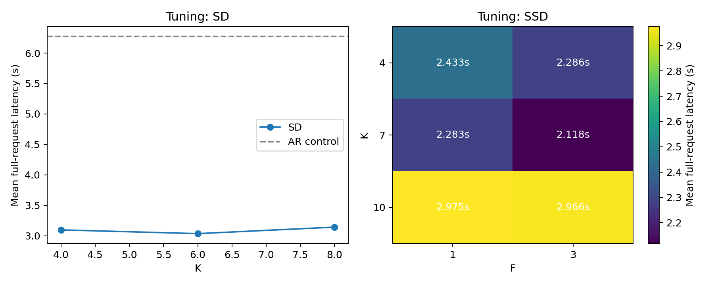
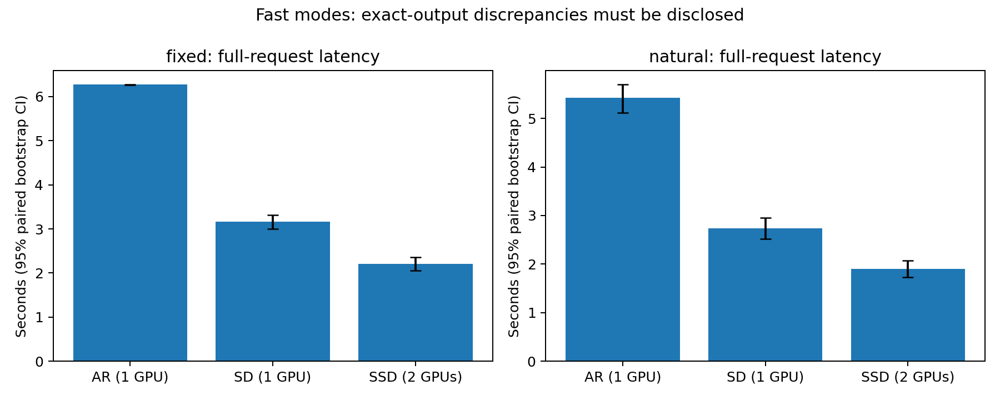

Numerical reference: shared-fixed16-v1 (new AR arithmetic). Exact agreement below is against this shared AR, not original historical AR. SSD request latency includes final obsolete-work draining.

# Evaluation 1 baseline experiments

**Performance measurements of fast implementations. Exact greedy equivalence is unresolved.**
Output mismatches are reported below; these are not established correctness-preserving acceleration results.

The 24 tuning and 75 held-out prompts are balanced across chat, code, and document tasks. Warmup uses three separate tuning prompts. Previously investigated held-out prompts are excluded. Weights/kernels are warm, prompt-prefix reuse is disabled, and no profiler is attached.

AR and SD each allocate one L40S; SSD allocates two. This is a latency comparison with an additional GPU for SSD. Every accepted block passed dedicated-GPU process monitoring.

Manifest: `aa249b4696114e7ed28e72646ff70f14ca2cac426e885267a60696899cdbf2aa`. Selection: `1f6a7913a0f848feb9de479b6038fa28caed5d5ee1ad3e6b9afdfe12dc21ce33`.

## Tuning and frozen selection

Each setting has 48 measured requests: 24 tuning prompts × two repetitions. The minimum mean fixed-256 request latency selects one global configuration per method; ties use smaller K/F. Held-out measurements are never used for selection.

| Configuration | Mean request latency (s) | Selected |
|---|---:|---|
| ar | 6.2726 | yes |
| sd_k4 | 3.0964 |  |
| sd_k6 | 3.0352 | yes |
| sd_k8 | 3.1418 |  |
| ssd_k4_f1 | 2.4331 |  |
| ssd_k4_f3 | 2.2857 |  |
| ssd_k7_f1 | 2.2831 |  |
| ssd_k7_f3 | 2.1176 | yes |
| ssd_k10_f1 | 2.9753 |  |
| ssd_k10_f3 | 2.9665 |  |

## Held-out comparisons

Each method/protocol has 375 requests: 75 prompts × five rounds. The 95% intervals use 10,000 paired bootstrap draws over rounds and prompt IDs, stratified by family. Speedup is AR mean latency divided by method mean latency.

Fixed 256-token output is primary. Natural EOS, capped at 256, is secondary and uses the same winners. Different output tokens can change EOS/length, so natural-EOS latency ratios may reflect different response lengths.

Exact matches use the AR output from round 0 as the fixed reference. Paired-round comparisons and first-divergence positions are also retained in summary.json. Repeatability compares each mode with its own round 0.

Draft acceptance is accepted draft tokens / verified draft tokens, excluding the recovery token. It describes verifier decisions before final EOS/output-cap trimming. Cache hit means SSD speculation-cache hit; prompt-prefix reuse is disabled.

### fixed

| Family | Method | GPUs | Mean / p50 / p95 (s) | tok/s | First delivery (s) | Mean output tokens | Tokens/step | Draft acceptance | Cache hit | AR / method latency (95% CI) | Exact requests / total | Repeatable prompts / total |
|---|---|---:|---|---:|---:|---:|---:|---:|---:|---|---|---|
| all | ar | 1 | 6.271 / 6.245 / 6.359 | 40.82 | 0.050 | 256.0 | 1.00 | — | — | 1.000× (1.000–1.000) | 375/375 | 75/75 |
| all | sd_k6 | 1 | 3.161 / 2.929 / 4.845 | 80.99 | 0.114 | 256.0 | 4.01 | 0.446 | — | 1.984× (1.889–2.092) | 375/375 | 75/75 |
| all | ssd_k7_f3 | 2 | 2.208 / 1.998 / 3.683 | 115.92 | 0.096 | 256.0 | 4.31 | 0.408 | 0.777 | 2.840× (2.665–3.049) | 375/375 | 75/75 |
| chat | ar | 1 | 6.239 / 6.238 / 6.251 | 41.03 | 0.032 | 256.0 | 1.00 | — | — | 1.000× (1.000–1.000) | 125/125 | 25/25 |
| chat | sd_k6 | 1 | 3.353 / 3.321 / 4.969 | 76.36 | 0.096 | 256.0 | 3.81 | 0.402 | — | 1.861× (1.662–2.124) | 125/125 | 25/25 |
| chat | ssd_k7_f3 | 2 | 2.382 / 2.556 / 3.954 | 107.46 | 0.083 | 256.0 | 4.06 | 0.363 | 0.754 | 2.619× (2.266–3.121) | 125/125 | 25/25 |
| code | ar | 1 | 6.245 / 6.243 / 6.258 | 41.00 | 0.034 | 256.0 | 1.00 | — | — | 1.000× (1.000–1.000) | 125/125 | 25/25 |
| code | sd_k6 | 1 | 2.333 / 2.318 / 2.756 | 109.72 | 0.098 | 256.0 | 5.00 | 0.657 | — | 2.676× (2.566–2.794) | 125/125 | 25/25 |
| code | ssd_k7_f3 | 2 | 1.434 / 1.419 / 1.898 | 178.54 | 0.080 | 256.0 | 5.51 | 0.629 | 0.886 | 4.355× (4.101–4.628) | 125/125 | 25/25 |
| doc | ar | 1 | 6.330 / 6.307 / 6.435 | 40.45 | 0.083 | 256.0 | 1.00 | — | — | 1.000× (1.000–1.000) | 125/125 | 25/25 |
| doc | sd_k6 | 1 | 3.796 / 3.784 / 4.732 | 67.43 | 0.149 | 256.0 | 3.22 | 0.353 | — | 1.667× (1.572–1.784) | 125/125 | 25/25 |
| doc | ssd_k7_f3 | 2 | 2.809 / 2.924 / 3.573 | 91.14 | 0.127 | 256.0 | 3.35 | 0.316 | 0.691 | 2.253× (2.096–2.446) | 125/125 | 25/25 |

### natural

| Family | Method | GPUs | Mean / p50 / p95 (s) | tok/s | First delivery (s) | Mean output tokens | Tokens/step | Draft acceptance | Cache hit | AR / method latency (95% CI) | Exact requests / total | Repeatable prompts / total |
|---|---|---:|---|---:|---:|---:|---:|---:|---:|---|---|---|
| all | ar | 1 | 5.419 / 6.236 / 6.318 | 40.81 | 0.048 | 221.2 | 1.00 | — | — | 1.000× (1.000–1.000) | 375/375 | 75/75 |
| all | sd_k6 | 1 | 2.737 / 2.493 / 4.391 | 80.81 | 0.112 | 221.2 | 3.98 | 0.443 | — | 1.980× (1.882–2.095) | 375/375 | 75/75 |
| all | ssd_k7_f3 | 2 | 1.902 / 1.611 / 3.261 | 116.27 | 0.092 | 221.2 | 4.27 | 0.404 | 0.766 | 2.849× (2.664–3.070) | 375/375 | 75/75 |
| chat | ar | 1 | 4.903 / 6.019 / 6.240 | 41.03 | 0.032 | 201.2 | 1.00 | — | — | 1.000× (1.000–1.000) | 125/125 | 25/25 |
| chat | sd_k6 | 1 | 2.710 / 2.485 / 4.957 | 74.22 | 0.095 | 201.2 | 3.84 | 0.384 | — | 1.809× (1.591–2.104) | 125/125 | 25/25 |
| chat | ssd_k7_f3 | 2 | 1.927 / 1.772 / 3.887 | 104.37 | 0.077 | 201.2 | 4.07 | 0.345 | 0.710 | 2.544× (2.149–3.116) | 125/125 | 25/25 |
| code | ar | 1 | 6.122 / 6.243 / 6.258 | 40.99 | 0.034 | 251.0 | 1.00 | — | — | 1.000× (1.000–1.000) | 125/125 | 25/25 |
| code | sd_k6 | 1 | 2.286 / 2.226 / 2.753 | 109.80 | 0.097 | 251.0 | 4.99 | 0.656 | — | 2.678× (2.563–2.801) | 125/125 | 25/25 |
| code | ssd_k7_f3 | 2 | 1.405 / 1.354 / 1.897 | 178.68 | 0.080 | 251.0 | 5.48 | 0.628 | 0.887 | 4.359× (4.095–4.644) | 125/125 | 25/25 |
| doc | ar | 1 | 5.233 / 5.752 / 6.372 | 40.40 | 0.079 | 211.4 | 1.00 | — | — | 1.000× (1.000–1.000) | 125/125 | 25/25 |
| doc | sd_k6 | 1 | 3.215 / 3.321 / 4.418 | 65.76 | 0.143 | 211.4 | 3.13 | 0.338 | — | 1.628× (1.542–1.736) | 125/125 | 25/25 |
| doc | ssd_k7_f3 | 2 | 2.375 / 2.431 / 3.245 | 89.03 | 0.121 | 211.4 | 3.24 | 0.301 | 0.701 | 2.204× (2.060–2.384) | 125/125 | 25/25 |

## Regressions and limits

Families with mean latency regressions versus AR: none.

These measurements cover greedy batch-one inference, the declared context/output limits and this workload mix. The slow numerical reference is separate and is not substituted into speed measurements. Confidence intervals quantify measured variability; they do not resolve output-equivalence failures.
